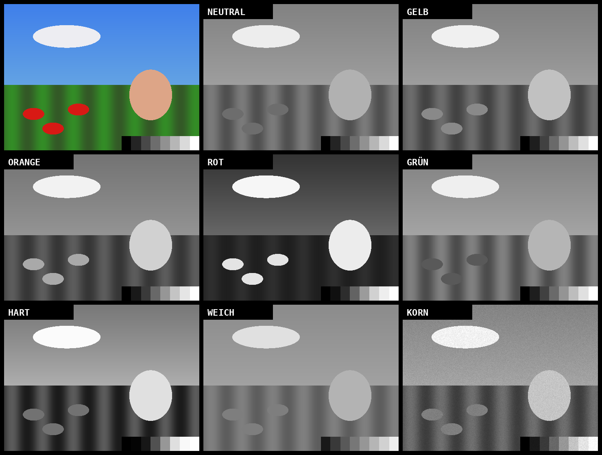

# Konzept: Cappuccino – Schwarz-Weiß-Kamera-App für iOS

> App-Name: **Cappuccino**
> Status: Konzept, Entscheidungen festgelegt · Plattform: iPhone (iOS 17+), nur Rückkamera
> Nicht kommerziell: kein Geschäftsmodell, keine Vermarktung

---

## 1. Vision

Eine Kamera-App, die **ausschließlich Schwarz-Weiß-Fotos** aufnimmt. Kein Bearbeiten nach der
Aufnahme, keine Galerie, keine Einstellungsflut. Die einzige kreative Entscheidung fällt **vor dem
Auslösen**: die Wahl des Filters. Wie bei analogem S/W-Film wird der Look beim Fotografieren
festgelegt – nicht danach.

**Leitsatz:** *Sehen in Graustufen, entscheiden vor dem Auslösen.*

## 2. Gestaltungsprinzipien

| Prinzip | Bedeutung für die App |
|---|---|
| **Ein Bildschirm** | Die gesamte App besteht aus dem Sucher. Keine Navigation, keine Tabs. |
| **Vorher statt nachher** | Filter werden nur vor der Aufnahme gewählt. Gespeichert wird das fertige S/W-Bild. |
| **Was du siehst, bekommst du** | Die Live-Vorschau zeigt exakt den Filter, der auch auf das Foto angewendet wird. |
| **Keine Farbe, nirgends** | Auch die Oberfläche ist rein monochrom (Schwarz, Weiß, Grautöne). |
| **Gesten vor Knöpfen** | So wenige sichtbare Bedienelemente wie möglich. |
| **Privat by Design** | Kein Netzwerk, kein Konto, kein Tracking. |

## 3. Zielgruppe

- Fotografie-Interessierte, die den reduzierten, analogen S/W-Ansatz schätzen
- Street- und Reportagefotograf:innen, die schnell und ohne Ablenkung fotografieren wollen
- Menschen, die bewusst „langsamer“ und gestalterisch fokussierter fotografieren möchten

## 4. Funktionsumfang

### 4.1 Muss (MVP)

1. **Live-Sucher in Schwarz-Weiß** (Vollbild, mit aktivem Filter in Echtzeit)
2. **Filterauswahl vor der Aufnahme** (8 Filter, siehe Kapitel 6)
3. **Zwei Seitenverhältnisse:** 4:3 (Standard) und 1:1 (quadratisch), Wahl vor der Aufnahme
4. **Auslöser** (Bildschirm-Button + Lautstärketasten)
5. **Speichern in die Foto-Mediathek** als S/W-HEIC in voller Auflösung
6. **Tippen zum Fokussieren/Belichten** (systemübliches Kameraverhalten, kein Bedienelement)
7. **Letzter Filter und letztes Format werden gemerkt**
8. **Nur Rückkamera** (Haupt-Weitwinkelkamera)

### 4.2 Kann (nach MVP, nur wenn es den Minimalismus nicht bricht)

- Steuerung der Filter über die **Kamerasteuerungstaste** (iPhone 16 und neuer, iOS 18)
- **Kamera vom Sperrbildschirm** starten (LockedCameraCapture, iOS 18)
- Kleine Vorschau des letzten Fotos, die direkt die Fotos-App öffnet

### 4.3 Bewusst nicht enthalten

- Farbaufnahmen oder Speichern des Farboriginals
- Frontkamera / Selfies
- Weitere Formate außer 4:3 und 1:1 (z. B. 16:9)
- Nachträgliche Bearbeitung, Regler, Zuschneiden
- Eigene Galerie, Alben-Verwaltung, Teilen-Funktionen
- Video, Live Photos, Porträtmodus, RAW
- Konten, Cloud, Social Features, Werbung, Analytics

## 5. Bedienkonzept & Oberfläche

### 5.1 Bildschirmaufbau (Hochformat)

```
┌──────────────────────────────┐
│             4:3              │  ← Formatumschalter (Tippen: 4:3 ↔ 1:1)
│                              │
│                              │
│         LIVE-SUCHER          │
│      (Schwarz-Weiß, mit      │
│       aktivem Filter)        │
│                              │
│                              │
│                              │
│                              │
│  ·  ·  ·  ●  ·  ·  ·  ·      │  ← Filter-Indikator (Punkte)
│           ORANGE             │  ← Filtername (blendet nach 1,5 s aus)
│                              │
│            ( ◯ )             │  ← Auslöser
└──────────────────────────────┘
```

Sichtbar sind dauerhaft nur **Sucher**, **Auslöser** und ein kleines **Format-Label** („4:3“ bzw.
„1:1“) am oberen Rand. Filtername und Punkte-Indikator erscheinen beim Filterwechsel und blenden
danach dezent aus.

### 5.2 Quadratisches Format (1:1)

```
┌──────────────────────────────┐
│             1:1              │
│▓▓▓▓▓▓▓▓▓▓▓▓▓▓▓▓▓▓▓▓▓▓▓▓▓▓▓▓▓▓│  ← schwarze Maske
│                              │
│                              │
│        QUADRATISCHER         │
│          BILDAUSSCHNITT      │
│                              │
│                              │
│▓▓▓▓▓▓▓▓▓▓▓▓▓▓▓▓▓▓▓▓▓▓▓▓▓▓▓▓▓▓│  ← schwarze Maske
│           ORANGE             │
│            ( ◯ )             │
└──────────────────────────────┘
```

- Der Sucher zeigt den **exakten quadratischen Ausschnitt**; die Bereiche außerhalb werden schwarz
  maskiert (weiche Überblendung beim Umschalten, ca. 0,25 s).
- Das Quadrat wird **mittig aus dem 4:3-Sensorbild** geschnitten (z. B. 12 MP 4032 × 3024 →
  3024 × 3024 px). Es wird nicht hochskaliert.
- Gespeichert wird **nur der quadratische Ausschnitt**, der Rest wird verworfen – konsequent wie
  beim Filter: Die Entscheidung fällt vor der Aufnahme.
- Das Format ist **unabhängig vom Filter**: Alle 8 Filter funktionieren in beiden Formaten.

### 5.3 Gesten

| Geste | Aktion |
|---|---|
| Horizontal wischen auf dem Sucher | Nächster / vorheriger Filter |
| Tippen auf das Format-Label | Umschalten 4:3 ↔ 1:1 |
| Tippen auf den Sucher | Fokus- und Belichtungspunkt setzen |
| Lang drücken auf den Sucher | Fokus/Belichtung sperren (AE/AF-Lock) |
| Vertikal ziehen nach dem Tippen | Belichtungskorrektur (± 2 EV) |
| Tippen auf Auslöser / Lautstärketaste | Foto aufnehmen |
| Kamerasteuerungstaste (iPhone 16+) | Gleiten = Filter wählen, Drücken = Auslösen |

### 5.4 Feedback

- **Haptik:** leichtes „Klicken“ bei jedem Filter- und Formatwechsel, kräftigeres Feedback beim Auslösen
- **Auslöse-Animation:** kurzes Abblenden des Suchers auf Schwarz (wie ein Verschluss)
- **Kein Ton** außer dem systemseitig vorgeschriebenen Auslösegeräusch

### 5.5 Visuelle Sprache

- Farben: ausschließlich `#000000`, `#FFFFFF` und wenige Grautöne
- Typografie: SF Pro (bzw. SF Mono für den Filternamen), Versalien, weite Laufweite
- Querformat: Der Sucher dreht nicht, nur Filtername, Format-Label und Auslöser-Beschriftung
  rotieren mit (wie bei der System-Kamera). Bei 4:3 im Querformat entsteht ein Bild im Querformat,
  bei 1:1 ist die Haltung egal.
- App-Icon: stilisierte Tasse von oben in Schwarz-Weiß – Milchschaum (Weiß) auf Espresso (Schwarz) als
  Sinnbild für die beiden Extreme der Graustufenskala

## 6. Die Filter

Die Filter orientieren sich an den klassischen **Farbfiltern der analogen S/W-Fotografie**: Ein
Filter vor dem Objektiv verändert, *wie hell* einzelne Farben im Graustufenbild erscheinen. Digital
wird das über einen **Kanalmischer** (Gewichtung von Rot, Grün, Blau) plus **Tonkurve** und optional
**Filmkorn** umgesetzt.



| # | Name | Kanalgewichtung R / G / B | Tonkurve | Korn | Wirkung |
|---|---|---|---|---|---|
| 1 | **Neutral** | 0,21 / 0,72 / 0,07 | linear | – | Natürliche Helligkeitsverteilung (Rec. 709 Luminanz) |
| 2 | **Gelb** | 0,35 / 0,55 / 0,10 | leicht S-förmig | – | Himmel etwas dunkler, Wolken treten hervor – der Allrounder |
| 3 | **Orange** | 0,50 / 0,42 / 0,08 | S-förmig | – | Dramatischerer Himmel, glattere Hauttöne |
| 4 | **Rot** | 0,85 / 0,15 / 0,00 | stark S-förmig | – | Fast schwarzer Himmel, hohe Dramatik, Landschaft & Architektur |
| 5 | **Grün** | 0,15 / 0,80 / 0,05 | leicht S-förmig | – | Laub hell und differenziert, Hauttöne kräftiger |
| 6 | **Hart** | 0,30 / 0,60 / 0,10 | sehr steil, tiefe Schwarztöne | – | Grafisch, kontrastreich, Street-Look |
| 7 | **Weich** | 0,25 / 0,65 / 0,10 | flach, angehobene Schatten | – | Matter, ruhiger Look, sanfte Übergänge |
| 8 | **Korn** | 0,30 / 0,60 / 0,10 | S-förmig | mittel | Analoger Filmcharakter mit sichtbarem Korn |

**Hinweise zur Filterdefinition**

- Die Gewichte summieren sich jeweils auf 1,0, damit die Gesamthelligkeit erhalten bleibt.
- Die Mischung erfolgt im **linearen Farbraum** (vor der Gammakorrektur) – nur so verhalten sich die
  Filter wie echte optische Filter.
- Das Ergebnis ist **echtes Grau** (R = G = B), keine Tonung (Sepia, Selen o. Ä.).
- Filter werden zentral in `MonoFilter.swift` definiert, damit sie ohne
  Codeänderung feinjustiert werden können.
- Bewusst **keine Namen realer Filmsorten**, um Marken-/Rechteprobleme zu vermeiden.

## 7. Technische Architektur

### 7.1 Stack

- **Sprache/UI:** Swift (Swift-6-Compiler, Sprachmodus 5), SwiftUI (Sucher als `UIViewRepresentable` mit `MTKView`)
- **Kamera:** AVFoundation (`AVCaptureSession`, `AVCaptureVideoDataOutput`, `AVCapturePhotoOutput`)
- **Bildverarbeitung:** Core Image auf der GPU mit eingebauten Filtern (`CIColorMatrix` als Kanalmischer,
  `CIColorCurves` als Tonkurve, `CIRandomGenerator` als Korn) – Core Image fasst sie zu einem Durchlauf
  zusammen, ein eigener Metal-Kernel ist nicht nötig
- **Speichern:** PhotoKit (`PHPhotoLibrary`, Berechtigung nur „Hinzufügen“)
- **Keine Drittanbieter-Abhängigkeiten**
- **Mindestversion:** iOS 17 (Kamerasteuerungstaste & Sperrbildschirm ab iOS 18 optional)

### 7.2 Module

Umsetzung: [`ios/`](../ios/README.md)

```
Cappuccino
├── App/
│   ├── CappuccinoApp     App-Einstieg
│   └── CameraModel       Zustand: Filter, Format, Fokus, Aufnahme, Ausrichtung
├── Camera/
│   └── CameraService     Session (nur Rückkamera), Fokus/Belichtung, Auslösen
├── Filters/
│   ├── MonoFilter        Die 8 Filter: Kanalgewichte, Tonkurve, Korn
│   ├── FilterEngine      Wendet einen MonoFilter auf ein CIImage an (Vorschau und Foto)
│   └── AspectRatio       Format 4:3 / 1:1, mittiger Bildausschnitt, Fokus-Koordinaten
├── Preview/
│   ├── PreviewRenderer   Rendert Videoframes mit aktivem Filter in eine MTKView
│   └── ViewfinderView    SwiftUI-Hülle, Lautstärketasten als Auslöser
├── Library/
│   ├── PhotoProcessor    Zuschnitt, Filter, Graustufen-HEIC, Metadaten
│   └── PhotoLibrary      Speichern (nur Hinzufügen-Berechtigung)
└── UI/
    ├── CameraScreen      Der eine Bildschirm inkl. Gesten, Maske, Fokusrahmen
    ├── FilterIndicator   Name + Punkte, Ein-/Ausblenden
    ├── FormatToggle      Label „4:3“ / „1:1“
    └── ShutterButton     Auslöser
```

### 7.3 Datenfluss

```
Kamera-Sensor
   ├─► Videoframes ──► FilterEngine ──► Formatmaske ──► MetalPreview (Live-Sucher)
   │
   └─► Auslösen ──► AVCapturePhoto (volle Auflösung, Farbe nur im Arbeitsspeicher)
                         └─► Zuschnitt (4:3 oder 1:1, mittig)
                               └─► FilterEngine (gleicher Filter) ──► S/W-HEIC ──► Foto-Mediathek
```

- Der **Zuschnitt erfolgt vor dem Filter**, damit nur die tatsächlich gespeicherten Pixel verarbeitet
  werden (schneller, weniger Speicher).
- **Ein und dieselbe `FilterEngine`** für Vorschau und Foto garantiert, dass das Ergebnis exakt der
  Vorschau entspricht.
- Die Farbdaten existieren **nur flüchtig im Arbeitsspeicher**. Gespeichert wird ausschließlich das
  S/W-Bild – das Foto ist damit „echter“ S/W-Film: unumkehrbar.
- Gespeichert wird als **HEIC, Graustufen-Farbprofil (Gray Gamma 2.2)**: kleinere Dateien, und auch
  andere Apps können keine Farbe „zurückholen“.
- Metadaten: Standard-EXIF (Belichtung, Brennweite, Datum) + Filtername und Format im Feld
  `UserComment` (z. B. „Cappuccino · Orange · 1:1“).
  Ortsdaten nur, wenn der Nutzer dies in der System-Kamera-Logik erlaubt (Standard: aus).

### 7.4 Performance-Ziele

| Kennzahl | Ziel |
|---|---|
| Kaltstart bis Sucher sichtbar | < 0,8 s |
| Live-Vorschau | 60 fps (ab iPhone 12), min. 30 fps (ältere Geräte) |
| Auslöseverzögerung | < 100 ms |
| Verarbeitung + Speichern 48 MP | < 1,5 s, im Hintergrund, nächstes Foto sofort möglich |

Maßnahmen: Vorschau in reduzierter Auflösung rendern, Korn als vorab berechnete Textur, wiederverwendeter
`CIContext`, keine CPU-Kopien der Pixelpuffer.

## 8. Datenschutz & Berechtigungen

| Berechtigung | Zweck | Text im Systemdialog (Entwurf) |
|---|---|---|
| Kamera | Fotografieren | „Cappuccino benötigt die Kamera, um Schwarz-Weiß-Fotos aufzunehmen.“ |
| Fotos (nur hinzufügen) | Speichern | „Cappuccino speichert deine Aufnahmen in deiner Mediathek. Lesezugriff ist nicht nötig.“ |

- **Kein** Lesezugriff auf die Mediathek, **kein** Netzwerkzugriff, **keine** Analytics
- Falls doch einmal über den App Store verteilt: Datenschutzangabe **„Keine Daten erfasst“**
- Verweigerte Berechtigung: schlichter S/W-Hinweis mit Button zu den Einstellungen

## 9. Barrierefreiheit

- VoiceOver: Auslöser („Foto aufnehmen“), Filter als anpassbares Element (Wischen hoch/runter wechselt
  den Filter, Ansage z. B. „Filter Orange, 3 von 8“), Format-Label als Schalter
  („Format quadratisch, Taste“)
- Dynamic Type für den Filternamen
- Alle Gesten auch über sichtbare Alternativen erreichbar (Tippen auf Filternamen öffnet kurz die
  Filterleiste)
- Respektiert „Bewegung reduzieren“ (keine Verschluss-Animation)
- Kontraste der Oberfläche durch reines Schwarz/Weiß ohnehin maximal

## 10. Erster Start

Kein Onboarding mit mehreren Seiten. Stattdessen:

1. Systemdialog Kamera-Berechtigung
2. Sucher erscheint sofort, Filter „Neutral“, Format 4:3
3. Einmaliger, dezenter Hinweis: „← Wischen für Filter →“ (verschwindet nach erstem Wischen)
4. Fotos-Berechtigung wird erst beim **ersten Auslösen** angefragt

## 11. Fahrplan

| Phase | Inhalt | Dauer (Richtwert) |
|---|---|---|
| **0 – Prototyp** | Kamera-Session, Live-Vorschau mit Kanalmischer, Filter-Feintuning an echten Motiven | 1–2 Wochen |
| **1 – MVP** | Alle 8 Filter, Formate 4:3 und 1:1, Auslösen, Speichern, Gesten, Haptik, Berechtigungen | 2–3 Wochen |
| **2 – Feinschliff** | Performance auf Altgeräten, Barrierefreiheit, Querformat, App-Icon, Tests | 1–2 Wochen |
| **3 – Beta & Verteilung** | TestFlight im kleinen Kreis, Feedback zu Filtern, Installation auf eigenen Geräten | 1–2 Wochen |
| **4 – Optional** | Kamerasteuerungstaste, Sperrbildschirm-Kamera | nach Bedarf |

**Verteilung:** Da keine Vermarktung geplant ist, wird Cappuccino nicht beworben und nicht verkauft.
Installiert wird direkt über Xcode bzw. TestFlight (bis zu 10.000 Tester:innen per Einladung). Ein
kostenloser App-Store-Eintrag ohne Marketing bleibt später möglich, ist aber kein Ziel.

## 12. Qualitätssicherung

- **Unit-Tests** für `FilterEngine`: Referenzbilder (Farbtafeln) → erwartete Graustufenwerte je Filter
- **Snapshot-Tests** der Oberfläche
- **Gerätetests** auf ältestem unterstütztem und aktuellem iPhone (Bildrate, Speicherbedarf, Wärme)
- **Abgleich Vorschau ↔ gespeichertes Foto** (Pixelvergleich, Toleranz < 1 %)

## 13. Risiken

| Risiko | Gegenmaßnahme |
|---|---|
| TestFlight-Builds laufen nach 90 Tagen ab | Regelmäßig neuen Build hochladen oder per Xcode direkt installieren |
| Ruckelnde Vorschau auf älteren Geräten | Vorschau-Auflösung adaptiv senken, Korn vorberechnen |
| Vorschau weicht vom Foto ab (Tone Mapping, HDR) | Gleiche Engine, HDR/Deep Fusion bewusst konfigurieren und testen |
| 1:1-Maske im Sucher passt nicht exakt zum gespeicherten Ausschnitt | Zuschnitt aus gemeinsamer `AspectRatio`-Logik für Vorschau und Foto, Pixeltest |
| Nutzer vermissen Farboriginal | Klare Kommunikation als bewusstes Konzept („wie S/W-Film“) |

## 14. Getroffene Entscheidungen

| Thema | Entscheidung |
|---|---|
| **Name** | Cappuccino |
| **Geschäftsmodell** | Keines – nicht kommerziell, keine Vermarktung |
| **Filter** | 8 Filter (Neutral, Gelb, Orange, Rot, Grün, Hart, Weich, Korn) |
| **Seitenverhältnis** | 4:3 (Standard) und zusätzlich 1:1 (quadratisch) |
| **Kamera** | Nur Rückkamera, keine Frontkamera |
