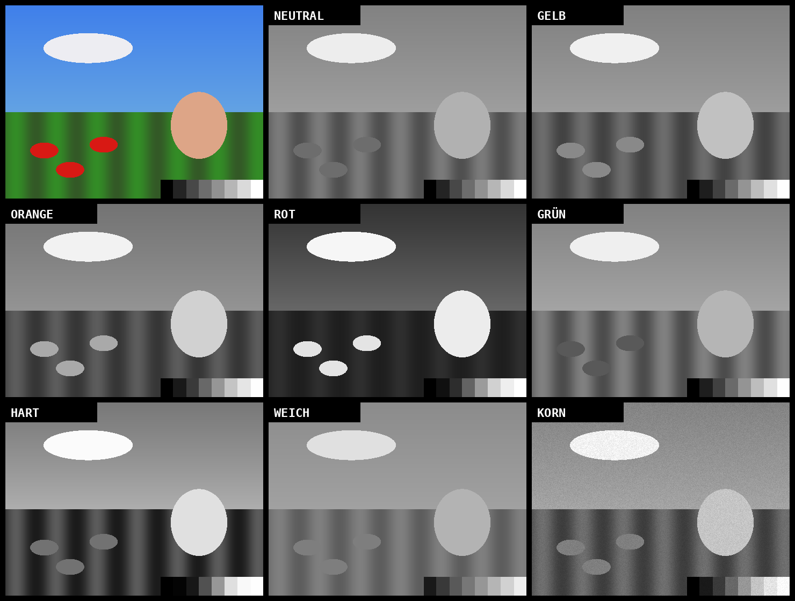

# Cappuccino – iOS-App

Minimalistische Kamera-App, die ausschließlich Schwarz-Weiß-Fotos aufnimmt.
Konzept: [`../docs/cappuccino-konzept.md`](../docs/cappuccino-konzept.md)



## Voraussetzungen

- Mac mit **Xcode 16** oder neuer
- [XcodeGen](https://github.com/yonaskolb/XcodeGen) (`brew install xcodegen`)
- iPhone mit **iOS 17** oder neuer – der Simulator hat keine Kamera

## Projekt erzeugen und starten

```bash
cd ios
xcodegen generate          # erzeugt Cappuccino.xcodeproj und Info.plist
open Cappuccino.xcodeproj
```

In Xcode:

1. Target **Cappuccino** → *Signing & Capabilities* → eigenes **Team** wählen
   (ein kostenloser Apple-Account reicht für das eigene iPhone; die App läuft dann 7 Tage,
   mit bezahltem Developer-Account 1 Jahr bzw. über TestFlight 90 Tage pro Build).
2. Ggf. die **Bundle-ID** `de.cappuccino.app` in `project.yml` anpassen, falls sie belegt ist.
3. iPhone anschließen, als Ziel wählen, **⌘R**.

Tests (laufen auch im Simulator): **⌘U**

## Bedienung

| Geste | Aktion |
|---|---|
| Waagerecht wischen | Filter wechseln (8 Filter, endlos) |
| Tippen auf „4:3“ / „1:1“ | Format umschalten |
| Tippen auf den Sucher | Fokus und Belichtung setzen |
| Lange drücken | Fokus/Belichtung sperren (AE/AF-Sperre) |
| Senkrecht ziehen | Belichtungskorrektur ±2 EV |
| Auslöser / Lautstärketasten | Foto aufnehmen |

## Aufbau

```
Cappuccino/
├── App/        CappuccinoApp (Einstieg), CameraModel (Zustand & Abläufe)
├── Camera/     CameraService – AVFoundation, nur Rückkamera
├── Filters/    MonoFilter (8 Filter), FilterEngine (Core Image), AspectRatio
├── Preview/    PreviewRenderer + ViewfinderView (Metal-Sucher)
├── Library/    PhotoProcessor (Zuschnitt, Filter, Graustufen-HEIC), PhotoLibrary
└── UI/         CameraScreen, FilterIndicator, FormatToggle, ShutterButton
```

**Bildpipeline** – identisch für Sucher und Foto:
Kanalmischer (linearer Farbraum) → Tonkurve (sRGB) → optional Korn → Graustufen.
Fotos werden mittig zugeschnitten (bei 1:1), gefiltert und als Graustufen-HEIC gespeichert;
die Farbdaten werden verworfen. Ortsdaten werden entfernt, Filter und Format stehen im EXIF-Kommentar.

Filter lassen sich in `Cappuccino/Filters/MonoFilter.swift` feinjustieren (Kanalgewichte, Tonkurve, Korn).

## Stand

Der Code wurde ohne Mac geschrieben und ist **noch nicht kompiliert oder auf einem Gerät
getestet**. Die Filtermathematik wurde separat nachgerechnet (siehe Vorschaubild oben).
Beim ersten Build sind kleinere Korrekturen möglich. Besonders zu prüfen:

- Sucher-Ausrichtung (falls das Bild auf dem Kopf steht: `CIRenderDestination.isFlipped` in `PreviewRenderer`)
- Ob das Gerät echtes Graustufen-HEIC schreibt (sonst greift automatisch ein RGB-Fallback)
- Bildrate des Suchers mit dem Filter „Korn“ auf älteren iPhones
